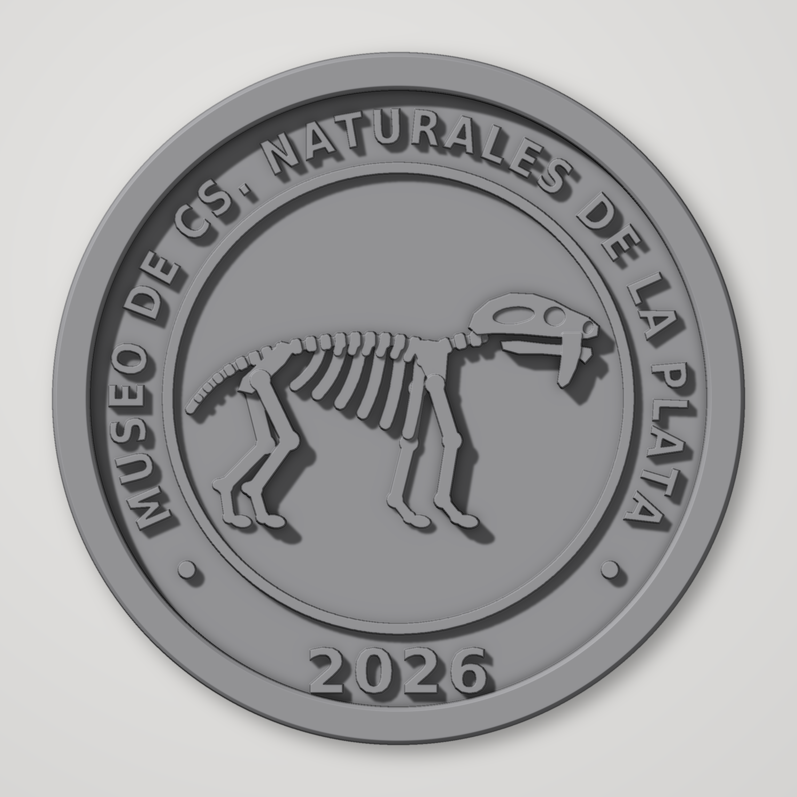

# Medallón conmemorativo – Museo de Cs. Naturales de La Plata 2026

Medallón en bajorrelieve imprimible en 3D con el esqueleto estilizado de un
*Smilodon* (tigre dientes de sable).



| Archivo | Descripción |
|---|---|
| `medallon_smilodon.stl` | Malla cerrada (manifold), lista para el slicer |
| `render_frontal.png` | Vista frontal estilo "clay render" (PLA gris mate) |
| `generar_medallon.py` | Script paramétrico que genera el STL y el render |

## Medidas
- Ø 80 mm, espesor del disco 3 mm, borde exterior hasta 5,6 mm.
- Leyenda superior en arco «MUSEO DE CS. NATURALES DE LA PLATA» y «2026» abajo,
  sans-serif bold, 1,2 mm de relieve.
- Esqueleto en capas de 0,8 / 1,3 / 1,7 / 2,1 / 2,3 mm sobre el campo, para dar
  profundidad. Huesos de ≥ 0,9 mm de ancho, sin costillas finas.
- Chaflán de 0,6 mm en la base para evitar la "pata de elefante".

## Impresión sugerida
- Cara plana sobre la cama, sin soportes.
- Capa de 0,12–0,16 mm (los relieves quedan más definidos), boquilla de 0,4 mm.
- 3 perímetros, 15–20 % de relleno.

## Regenerar / modificar
```bash
pip install numpy shapely manifold3d trimesh matplotlib pillow scipy
python3 generar_medallon.py
```
Los parámetros (diámetro, alturas, texto, año) están al principio del script.
